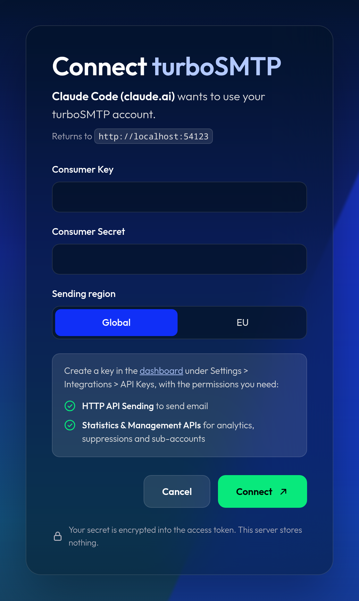
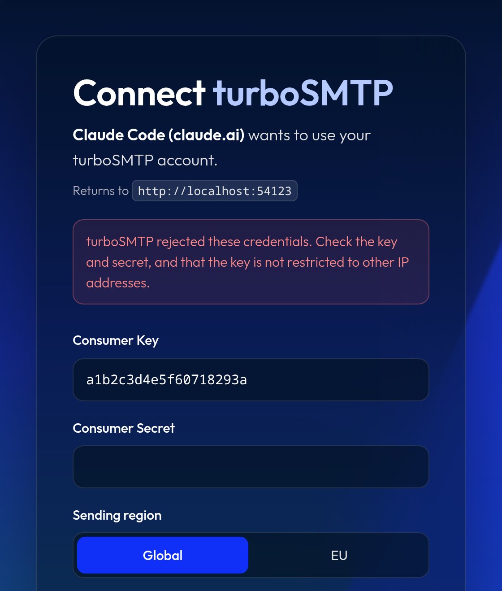

**Status: In development.** The hosted server is not public yet. This page describes the current build; the server URL and details can change before release.

The turboSMTP MCP server connects AI assistants to your account through the [Model Context Protocol](https://modelcontextprotocol.io). Once connected, you can ask your assistant to send a test email, explain why a message bounced, check your domain's DNS, or write integration code against the documented API.

turboSMTP hosts the server at:

```text
https://mcp.turbo-smtp.com/mcp
```

It forwards each request to the turboSMTP API with your Consumer Key and Consumer Secret and stores nothing. Sending uses the Global endpoint (`api.turbo-smtp.com`) or the EU endpoint (`api.eu.turbo-smtp.com`) you choose. turboSMTP is an Italian company with its own European servers, so EU sending stays in Europe.

## Before you start

Create a Consumer Key and Consumer Secret in the [dashboard](https://dashboard.serversmtp.com) under **Settings → Integrations → API Keys → Edit**. See [API keys](/get-started/api-keys). Enable the permissions for the tools you want:

| Dashboard permission | Needed for |
| --- | --- |
| **HTTP API Sending** | `send_email` |
| **Statistics & Management APIs** | Analytics, suppressions, email validation, and sub-account tools |

<Note>
  If your key is restricted to specific IP addresses, requests from the MCP server are rejected. Use a key without an IP restriction for the MCP server.
</Note>

## Connect your client

Most clients sign in through your browser. Add the server URL and the client opens a turboSMTP page where you enter your Consumer Key, Consumer Secret, and sending region.

<Tabs>
  <Tab title="Claude Code">
    ```bash
    claude mcp add --transport http turbosmtp https://mcp.turbo-smtp.com/mcp
    ```

    Start Claude Code, run `/mcp`, select **turbosmtp**, and choose **Authenticate**. Your browser opens the sign-in page.
  </Tab>

  <Tab title="Claude">
    In Claude on the web or desktop, open **Settings → Connectors**, choose **Add custom connector**, and enter `https://mcp.turbo-smtp.com/mcp`. Select **Connect** to open the sign-in page.

    On Team and Enterprise plans, an owner can add the connector for the whole organization.
  </Tab>

  <Tab title="ChatGPT">
    Turn on developer mode in ChatGPT's connector settings, then create a connector with the URL `https://mcp.turbo-smtp.com/mcp` and OAuth authentication. ChatGPT opens the sign-in page when you connect.
  </Tab>

  <Tab title="Cursor">
    Add the server to `~/.cursor/mcp.json`, or `.cursor/mcp.json` in your project:

    ```json mcp.json
    {
      "mcpServers": {
        "turbosmtp": {
          "url": "https://mcp.turbo-smtp.com/mcp"
        }
      }
    }
    ```

    Open **Cursor Settings → MCP** and select **Needs login** next to turbosmtp.
  </Tab>

  <Tab title="VS Code">
    Run **MCP: Add Server** from the Command Palette, choose **HTTP**, and enter `https://mcp.turbo-smtp.com/mcp`. Or add it to `.vscode/mcp.json`:

    ```json .vscode/mcp.json
    {
      "servers": {
        "turbosmtp": {
          "type": "http",
          "url": "https://mcp.turbo-smtp.com/mcp"
        }
      }
    }
    ```

    VS Code asks you to sign in when the server starts.
  </Tab>
</Tabs>

### Sign in

<Steps>
  <Step title="Check the client">
    The page shows which client is asking for access and where you return afterwards, for example `http://localhost` for Claude Code. Continue only if you started the connection yourself.
  </Step>

  <Step title="Enter your credentials">
    Paste your **Consumer Key** and **Consumer Secret**, and choose **Global** or **EU** as the sending region.
  </Step>

  <Step title="Connect">
    Select **Connect**. turboSMTP checks the credentials without sending mail, and your client receives an access token.
  </Step>
</Steps>

<Frame caption="The sign-in page, opened from Claude Code">
  
</Frame>

### Use a static token instead

Clients that can send custom HTTP headers can skip the browser sign-in. The bearer token is your Consumer Key and Consumer Secret, joined by a colon and base64-encoded:

```bash
TOKEN=$(printf '%s:%s' "$TURBOSMTP_CONSUMER_KEY" "$TURBOSMTP_CONSUMER_SECRET" | base64 -w0)

claude mcp add --transport http turbosmtp https://mcp.turbo-smtp.com/mcp \
  --header "Authorization: Bearer $TOKEN" \
  --header "X-TurboSMTP-Region: eu"
```

`X-TurboSMTP-Region` is optional. It defaults to `global`; set it to `eu` to send through `api.eu.turbo-smtp.com`. Treat the token like a password: it contains your secret.

## What you can ask

- "Send a test email from noreply@example.com to me@example.com."
- "How did our email do last week? Show bounces and the most common errors."
- "Why didn't jane@example.com get our password reset email?"
- "Is example.com set up correctly for sending through turboSMTP?"
- "Add turboSMTP email sending to this Laravel app."

## Tools

| Tool | What it does |
| --- | --- |
| `send_email` | Sends a transactional email with text or HTML, CC, BCC, custom headers, and attachments. |
| `delivery_summary` | Counts messages per status for a date range, with delivery, bounce, open, and click rates and the most common errors. |
| `list_sent_emails` | Lists sent messages with status and error details, filtered by date, status, recipient, sender, subject, or domain. |
| `get_sent_email` | Returns one message with its delivery status and error. |
| `check_domain_setup` | Checks SPF, DKIM (selector `turbo-smtp`), and DMARC for a sending domain and returns the record to publish for anything missing. |
| `search_docs` | Searches this documentation and returns matching sections with links. |
| `list_suppressions` | Lists suppressed addresses (bounces, spam complaints, unsubscribes, manual entries). |
| `add_suppressions` | Adds addresses to the suppression list. |
| `remove_suppressions` | Removes addresses from the suppression list. Marked as destructive, so clients can ask you to confirm first. |
| `validate_email` | Validates one address. Each call uses one [email validation](/account/email-validation) credit. |
| `get_account_info` | Reads your account profile. |
| `list_subaccounts`, `get_subaccount` | Read your [sub-accounts](/account/subaccounts). |

Message ids are passed as strings because they exceed the integer range JSON numbers can hold exactly.

## Prompts

Clients that support MCP prompts offer these as ready-made commands. In Claude Code, type `/mcp__turbosmtp__` to see them.

| Prompt | Arguments | What it does |
| --- | --- | --- |
| `debug-delivery` | `recipient` | Traces recent messages, errors, suppressions, and the sender domain for one recipient, then explains the cause and the fix. |
| `setup-domain` | `domain` | Checks the domain and lists the exact SPF, DKIM, and DMARC records to publish. See [SPF, DKIM, and DMARC](/deliverability/spf-dkim-dmarc). |
| `integrate` | `stack`, `migrate_from` (optional) | Adds turboSMTP sending to the project open in your editor, or migrates it from another provider. |

## Security

- **No stored credentials.** The server keeps no database. After sign-in, your Consumer Key and Secret are encrypted into the access token that your client holds.
- **Token lifetime.** Access tokens last one hour and renew automatically. After 30 days without use, you sign in again.
- **Revoke access.** Delete the Consumer Key in the dashboard. Every token created from it stops working immediately.
- **Least privilege.** Create a dedicated key for the MCP server and enable only the permissions you need. A key with only **HTTP API Sending** can send but cannot read analytics.

## Troubleshooting

<AccordionGroup>
  <Accordion title="The sign-in page says turboSMTP rejected the credentials">
    Check that you copied the full Consumer Key and Consumer Secret, and that the key has at least one of the permissions above. A key restricted to other IP addresses is rejected as well.

    <Frame>
      
    </Frame>
  </Accordion>

  <Accordion title="A tool returns HTTP 401">
    The key works but lacks the permission for that tool. Enable **HTTP API Sending** for `send_email`, or **Statistics & Management APIs** for the other tools, in **Settings → Integrations → API Keys → Edit**.
  </Accordion>

  <Accordion title="My client does not support OAuth sign-in">
    Use a [static token](#use-a-static-token-instead) in the `Authorization` header.
  </Accordion>

  <Accordion title="Email is sent from the wrong region">
    The region is chosen at sign-in. Disconnect and sign in again with the other region, or set `X-TurboSMTP-Region` when you use a static token.
  </Accordion>
</AccordionGroup>

## Resources

<CardGroup cols={2}>
  <Card title="API Keys" icon="key" href="/get-started/api-keys">
    Create a Consumer Key and Secret with the right permissions.
  </Card>

  <Card title="Email API" icon="paper-plane" href="/sending/email-api">
    The `POST /mail/send` request the MCP server uses to send.
  </Card>

  <Card title="SPF, DKIM, and DMARC" icon="shield-check" href="/deliverability/spf-dkim-dmarc">
    The records `check_domain_setup` verifies.
  </Card>

  <Card title="Model Context Protocol" icon="plug" href="https://modelcontextprotocol.io">
    The open protocol AI clients use to connect to the server.
  </Card>
</CardGroup>
